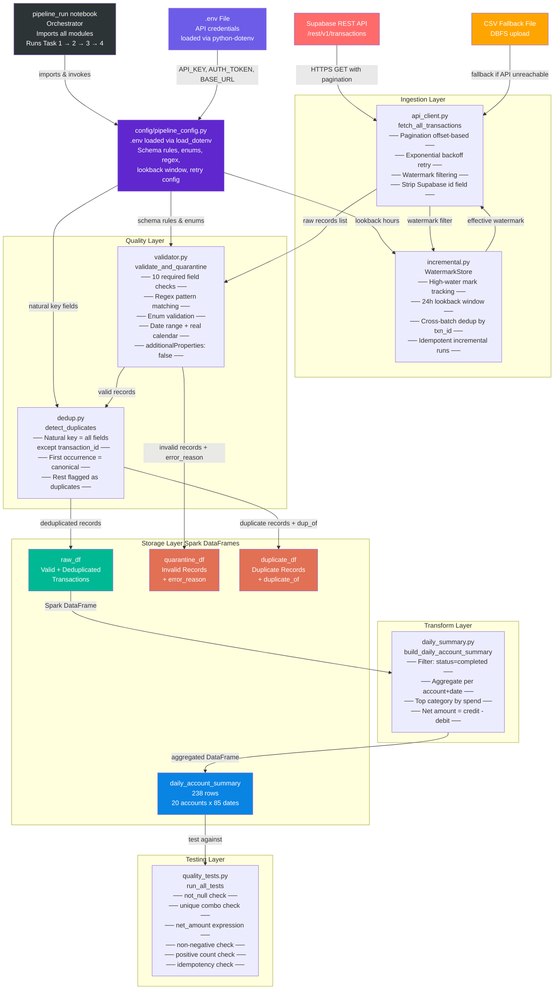
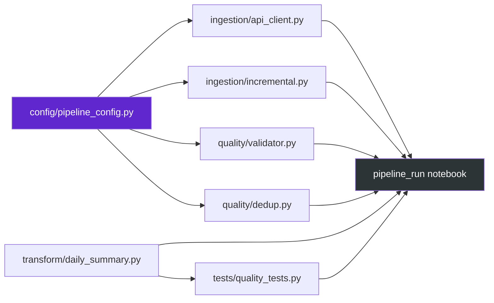

# Transaction Pipeline Architecture

## Architecture Diagram



---

## Pipeline Flow: Step-by-Step Explanation

### Step 0 — Orchestration & Setup (`pipeline_run` notebook)

The `pipeline_run` notebook is the entry point for the entire pipeline. It:

* Installs `python-dotenv` via `%pip install` and adds the project root (`/Workspace/electorolux_tech_assessment`) to `sys.path` so all modules can be imported as packages.
* On importing `config.pipeline_config`, the module automatically loads API credentials from the `.env` file at the project root using `load_dotenv()`. No API keys are hardcoded in source code.
* Imports every module: `config.pipeline_config`, `ingestion.api_client`, `ingestion.incremental`, `quality.validator`, `quality.dedup`, `transform.daily_summary`, `tests.quality_tests`.
* Uses `importlib.reload()` to hot-reload modules during development without restarting the kernel.
* Executes the four tasks sequentially: Raw Ingestion → Daily Summary → Incremental Ingestion → Design Note.

---

### Step 1 — API Fetch with Pagination & Retry (`ingestion/api_client.py`)

**Module:** `api_client.py` → function `ingest()` → `fetch_all_transactions()`

The pipeline starts by fetching all transaction records from a Supabase REST API.

**Pagination:**
* Uses offset-based pagination with a page size of 100 records.
* Each page is fetched via `GET /transactions?limit=100&offset=N&order=transaction_date.asc`.
* Pagination stops when an empty response or fewer-than-page-size batch is returned — no hardcoded total count is assumed.

**Retry with Exponential Backoff:**
* HTTP 429 (rate limit) and 5xx (server errors) trigger a retry with exponential backoff.
* Initial backoff is 1 second, doubling each retry, up to 5 attempts.
* Timeouts and connection errors are also retried.
* Non-retryable errors (e.g., 404, 403) return immediately.

**CSV Fallback:**
* If the API is completely unreachable after all retries, the pipeline falls back to a pre-uploaded CSV file in DBFS.
* The CSV is read via Spark, with `amount` cast to double.

**Supabase Field Stripping:**
* The API returns an internal Supabase `id` field that is not part of our schema. This field is stripped from every record before validation.

**Output:** A list of raw transaction dictionaries (352 records in the assessment dataset).

---

### Step 2 — Schema Validation & Quarantine (`quality/validator.py`)

**Module:** `validator.py` → function `validate_and_quarantine()`

Each raw record is validated against the JSON schema rules defined in `pipeline_config.py`.

**Validation Checks (per record):**

| Check | Rule |
| --- | --- |
| Required fields | All 10 fields present and non-empty: `transaction_id`, `account_id`, `transaction_date`, `amount`, `currency`, `transaction_type`, `merchant_name`, `merchant_category`, `status`, `country_code` |
| additionalProperties: false | No unexpected fields (ignoring `_` prefixed metadata fields) |
| `transaction_id` | Regex `^TXN-[A-Z0-9]+$` |
| `account_id` | Regex `^ACC-\d{4}$` |
| `transaction_date` | ISO 8601 UTC format, real calendar date, between 2024-01-01 and 2024-03-31 |
| `amount` | Strictly positive (> 0), rounded to 2 decimal places (multiple of 0.01) |
| `currency` | Enum: USD, EUR, GBP, CHF, JPY, AUD, CAD |
| `transaction_type` | Enum: debit, credit (case-sensitive, lowercase only) |
| `merchant_name` | Non-empty, non-whitespace |
| `merchant_category` | Enum: 12 valid categories (e-commerce, travel, etc.) |
| `status` | Enum: completed, pending, failed, reversed (case-sensitive, lowercase only) |
| `country_code` | ISO 3166-1 alpha-2, officially assigned (UK and EN are NOT valid) |

**Quarantine Mechanism:**
* Invalid records are routed to a quarantine/dead-letter layer with `_error_reason` and `_ingested_at` metadata.
* Valid records are tagged with `_ingested_at` timestamp and passed forward.
* In the assessment: 349 valid, 3 quarantined (invalid dates, wrong-case enums, invalid country codes).

**Output:** Two lists — `valid_records` (349) and `quarantine_records` (3).

---

### Step 3 — Natural-Key Duplicate Detection (`quality/dedup.py`)

**Module:** `dedup.py` → function `detect_duplicates()`

The assessment defines a duplicate as: *records that represent the same real-world transaction but have different `transaction_id` values and identical values across all other fields.*

**Strategy:**
* The **natural key** is all fields **except** `transaction_id` (9 fields): `account_id`, `transaction_date`, `amount`, `currency`, `transaction_type`, `merchant_name`, `merchant_category`, `status`, `country_code`.
* Records are grouped by their natural key (computed as a hashable tuple).
* If a group has more than 1 record, the first occurrence is kept as **canonical** and the rest are flagged as **duplicates**.
* Duplicate records are annotated with `_duplicate_of` (pointing to the canonical `transaction_id`) and `_duplicate_reason`.
* An `OrderedDict` preserves insertion order so the first-seen record is deterministic.

**Output:** Two lists — `deduped_records` (344) and `duplicate_records` (5). Each deduped record is the canonical version.

---

### Step 4 — Persist as Spark DataFrames (`transform/daily_summary.py`)

**Module:** `daily_summary.py` → functions `create_raw_dataframe()`, `create_quarantine_dataframe()`, `create_duplicate_dataframe()`

The validated and deduplicated Python dictionaries are converted into typed Spark DataFrames:

* `raw_df` — Valid, deduplicated records with an explicit `StructType` schema. The `amount` field is cast to `DoubleType` (API returns strings). A `transaction_ts` timestamp column is derived from `transaction_date`.
* `quarantine_df` — Invalid records with `_error_reason` column. Handles edge cases where `amount` may not be parseable.
* `duplicate_df` — Duplicate records with `_duplicate_of` and `_duplicate_reason` columns.

All three DataFrames use explicit schemas (not `inferSchema`) for type safety and reproducibility.

---

### Step 5 — Daily Account Summary Transformation (`transform/daily_summary.py`)

**Module:** `daily_summary.py` → function `build_daily_account_summary()`

This is the core transformation that produces the gold-layer reporting table.

**Filter:**
* Only records where `status = 'completed'` are included in the aggregation (265 out of 344 valid records).

**Aggregation (per `account_id` + `transaction_date`):**

| Output Column | Logic |
| --- | --- |
| `total_debit_amount` | `SUM(amount)` where `transaction_type = 'debit'`, rounded to 2 decimals |
| `total_credit_amount` | `SUM(amount)` where `transaction_type = 'credit'`, rounded to 2 decimals |
| `net_amount` | `total_credit_amount - total_debit_amount`, rounded to 2 decimals |
| `transaction_count` | `COUNT(*)` of completed transactions for that account+date |
| `distinct_merchants` | `COUNT(DISTINCT merchant_name)` |
| `currencies` | `array_sort(array_distinct(collect_set(currency)))` — sorted distinct array |
| `top_category` | Merchant category with highest total spend (via window function `row_number()`) |
| `updated_at` | `current_timestamp()` — when the row was computed |

**Top Category Logic:**
* A separate aggregation computes per-category spend for each account+date.
* A `row_number()` window function ranks categories by `category_total DESC`.
* Only rank = 1 (the top category) is joined back to the main summary.

**Output:** `daily_account_summary` DataFrame — 238 rows (20 accounts × 85 dates).

---

### Step 6 — Data Quality Tests (`tests/quality_tests.py`)

**Module:** `quality_tests.py` → function `run_all_tests()`

These tests are the Python equivalent of dbt `schema.yml` tests. Six assertions are run against the `daily_account_summary` DataFrame:

| # | Test | Rule |
| --- | --- | --- |
| 1 | **not_null** | `account_id` and `transaction_date` are never null |
| 2 | **unique** | Exactly one row per `(account_id, transaction_date)` combination — no duplicate combos |
| 3 | **expression** | `net_amount` = `total_credit_amount - total_debit_amount` (rounded to 2 decimals) |
| 4 | **non_negative** | `total_debit_amount >= 0` and `total_credit_amount >= 0` |
| 5 | **positive** | `transaction_count > 0` (every row represents at least one transaction) |
| 6 | **idempotent** | Recomputing the summary from the same input produces the same row count |

Each test prints `[PASS]` or `[FAIL]` with detail. A summary line shows total passed/failed.

---

### Step 7 — Incremental Ingestion with Watermark (`ingestion/incremental.py`)

**Module:** `incremental.py` → `WatermarkStore` class + helper functions

This step demonstrates idempotent incremental ingestion for production recurring runs.

**WatermarkStore:**
* Tracks the **high-water mark** — the maximum `transaction_date` ingested across all runs.
* Stores run metadata: `last_run_at`, `total_records_ingested`, and a `run_history` list.
* In production, this would be persisted as a Delta table or key-value store. For the assessment, an in-memory store with JSON serialization is used.

**Lookback Window (24 hours):**
* `compute_effective_watermark()` subtracts `LOOKBACK_WINDOW_HOURS` (24h) from the raw high-water mark.
* This creates an overlap window that catches **late-arriving data** — records that arrive with a `transaction_date` slightly before the last watermark.
* Without the lookback window, late records would be skipped entirely.

**Incremental Run Flow (Run 1 → Run 2):**

* **Run 1 (Initial Backfill):**
  * Watermark is `None` → fetch ALL records (no filter).
  * 352 records fetched → validate → quarantine → dedup → 344 valid records persisted.
  * Watermark updated to `max(transaction_date)` across all valid records.

* **Run 2 (Incremental):**
  * Effective watermark = raw watermark minus 24h lookback.
  * API is called with `transaction_date=gte.{effective_watermark}` filter.
  * Fetched records are filtered by `filter_by_watermark()` to ensure they fall at or after the effective watermark.
  * Cross-batch deduplication via `deduplicate_against_existing()` compares new record `transaction_id`s against the existing set — any already-seen IDs are excluded.
  * Result: 9 records fetched, all already in raw layer → 0 new inserts. **Idempotent.**

**Helper Functions:**

| Function | Purpose |
| --- | --- |
| `safe_parse_date()` | Safely parse ISO 8601 UTC date string, returns `None` if invalid |
| `filter_by_watermark()` | Keep only records at or after the effective watermark; skip invalid dates |
| `deduplicate_against_existing()` | Remove records whose `transaction_id` already exists in the existing set; returns `(truly_new, already_seen)` |

---

## Module Dependency Graph



---

## Project File Structure

```
electorolux_tech_assessment/
├── config/
│   ├── __init__.py
│   └── pipeline_config.py          # Shared config: API settings, schema rules, enums, regex patterns
│
├── ingestion/
│   ├── __init__.py
│   ├── api_client.py               # API fetch with pagination, retry, CSV fallback
│   └── incremental.py              # WatermarkStore, lookback window, cross-batch dedup
│
├── quality/
│   ├── __init__.py
│   ├── validator.py                # Schema validation, quarantine with error_reason
│   └── dedup.py                    # Natural-key duplicate detection
│
├── transform/
│   ├── __init__.py
│   └── daily_summary.py           # Daily account summary (Spark aggregation)
│
├── tests/
│   ├── __init__.py
│   └── quality_tests.py            # 6 data quality assertions
│
├── docs/
│   ├── product_platform_note.md   # Product & platform design note
│   └── architecture_diagram.md     # This file
│
├── pipeline_run                    # Main orchestrator notebook (modular)
└── Senior DE Assessment Pipeline   # Original monolithic notebook
```

---

## Data Flow Summary

```
Supabase REST API (352 records)
    │
    ▼
[api_client.ingest()]  ── pagination + retry + CSV fallback
    │
    ▼ raw_records (352)
    │
[validator.validate_and_quarantine()]  ── 10 schema checks per record
    │                         │
    ▼ valid (349)             ▼ quarantine (3) ──► quarantine_df
    │
[dedup.detect_duplicates()]  ── natural key dedup (all fields except txn_id)
    │                         │
    ▼ deduped (344)           ▼ duplicates (5) ──► duplicate_df
    │
[daily_summary.create_raw_dataframe()]  ── Python list → Spark DataFrame
    │
    ▼ raw_df
    │
[daily_summary.build_daily_account_summary()]  ── filter completed → aggregate
    │
    ▼ daily_account_summary (238 rows: 20 accounts × 85 dates)
    │
[quality_tests.run_all_tests()]  ── 6 assertions, all PASS
    │
    ▼ ✅ Pipeline complete
```

---

## Key Design Principles

* **Modularity:** Every module is independently importable. The orchestrator imports all modules and runs the full pipeline. Each module has a single responsibility.
* **Single Source of Truth:** All schema rules, enums, regex patterns, and API settings live in `pipeline_config.py`. No module hardcodes validation rules.
* **Idempotency:** Both the daily summary and incremental ingestion produce identical results when rerun with the same input. The watermark store with cross-batch dedup ensures no duplicate inserts across runs.
* **Quarantine over Rejection:** Invalid records are not dropped — they are quarantined with an `error_reason` for downstream inspection and debugging.
* **Late-Arriving Data:** The 24-hour lookback window on the watermark ensures records that arrive slightly before the last high-water mark are still captured.
* **Resilience:** Exponential backoff retry handles transient API failures. CSV fallback ensures the pipeline can still run in network-restricted environments.
* **Explicit Schemas:** All Spark DataFrames use explicit `StructType` schemas instead of `inferSchema` for type safety and reproducibility.