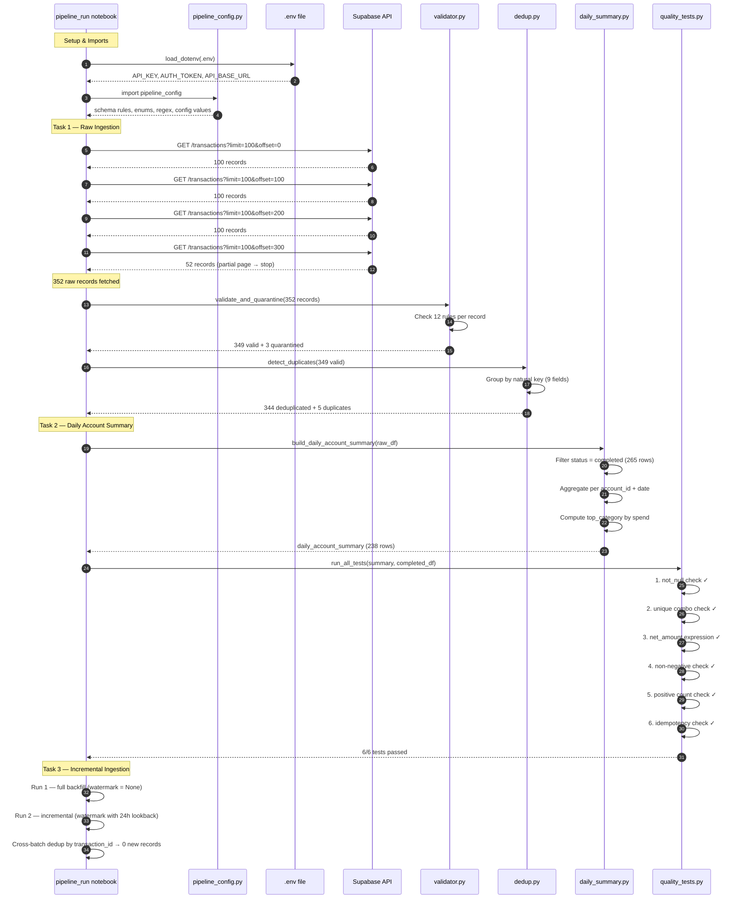
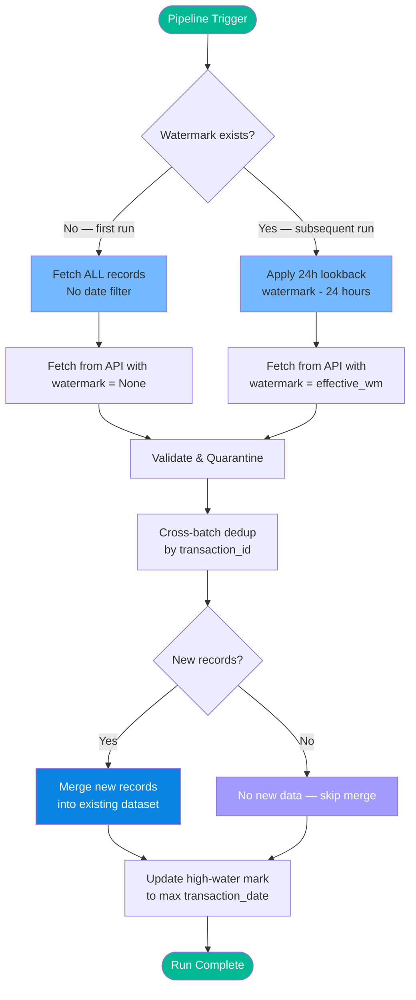
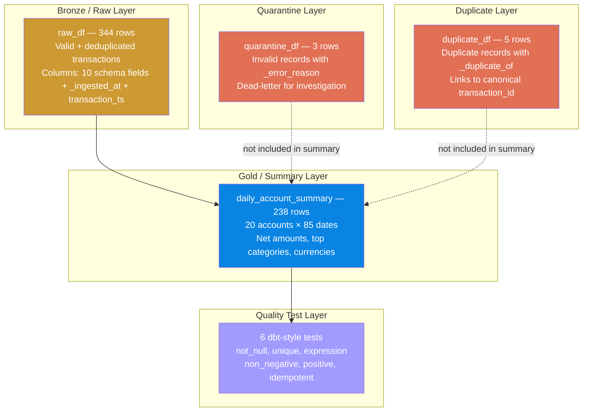

# Pipeline Flow Diagram

This document shows the step-by-step data flow of the transaction ingestion pipeline, from API source to the final daily account summary output.

---

## High-Level Flow

```mermaid
flowchart LR
    %% ─── Source ───
    API["🌐 Supabase REST API<br/>/rest/v1/transactions"]
    CSV["📄 CSV Fallback<br/>DBFS upload"]
    ENV["🔑 .env File<br/>API credentials"]

    %% ─── Ingestion ───
    FETCH["🔄 Fetch with Pagination<br/>100 records/page<br/>Exponential backoff retry"]
    STRIP["✂️ Strip Supabase id field"]

    %% ─── Validation ───
    VALIDATE["✅ Schema Validation<br/>12 checks per record"]

    %% ─── Split ───
    QUAR{"Valid?"}

    %% ─── Dedup ───
    DEDUP["🔍 Natural-Key Dedup<br/>All fields except transaction_id"]

    %% ─── Split 2 ───
    DUPCHK{"Duplicate?"}

    %% ─── Transform ───
    FILTER["🔎 Filter: status = completed"]
    AGG["📊 Aggregate<br/>per account + date"]
    TOPCAT["🏷️ Top category by spend"]

    %% ─── Outputs ───
    RAW_OUT["📦 raw_df<br/>344 records"]
    QUAR_OUT["⚠️ quarantine_df<br/>3 records + error_reason"]
    DUP_OUT["🔁 duplicate_df<br/>5 records + duplicate_of"]
    GOLD_OUT["🏆 daily_account_summary<br/>238 rows"]
    TESTS["🧪 6 Quality Tests<br/>All passing"]

    %% ─── Flow ───
    ENV -->|loads credentials| FETCH
    API -->|HTTPS GET| FETCH
    CSV -->|fallback if API down| FETCH
    FETCH --> STRIP
    STRIP -->|352 records| VALIDATE
    VALIDATE --> QUAR
    QUAR -->|valid: 349| DEDUP
    QUAR -->|invalid: 3| QUAR_OUT
    DEDUP --> DUPCHK
    DUPCHK -->|canonical: 344| RAW_OUT
    DUPCHK -->|duplicate: 5| DUP_OUT
    RAW_OUT --> FILTER
    FILTER -->|265 completed| AGG
    AGG --> TOPCAT
    TOPCAT --> GOLD_OUT
    GOLD_OUT --> TESTS

    %% ─── Styling ───
    style API fill:#ff6b6b,color:#fff
    style CSV fill:#ffa502,color:#fff
    style ENV fill:#5f27cd,color:#fff
    style FETCH fill:#74b9ff,color:#333
    style VALIDATE fill:#55efc4,color:#333
    style QUAR fill:#fdcb6e,color:#333
    style DEDUP fill:#55efc4,color:#333
    style DUPCHK fill:#fdcb6e,color:#333
    style RAW_OUT fill:#00b894,color:#fff
    style QUAR_OUT fill:#e17055,color:#fff
    style DUP_OUT fill:#e17055,color:#fff
    style GOLD_OUT fill:#0984e3,color:#fff
    style TESTS fill:#a29bfe,color:#fff
```

---

## Detailed Sequence: Full Ingestion Run

---

## Incremental Ingestion Flow

---

## Data Layer Summary

